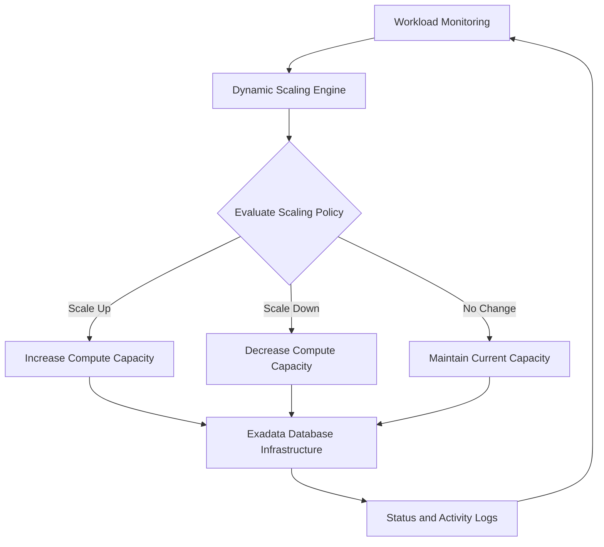

# Oracle Exadata Dynamic Scaling: Architecture, Implementation and Cost Optimization

## 1. Introduction

Oracle Exadata Cloud Service (ExaCS) provides a powerful database platform for enterprise workloads. However, database workloads are not always consistent throughout the day. Production systems may experience high demand during business hours, while development and non-production environments may require fewer compute resources.

Maintaining maximum compute capacity at all times can result in unnecessary infrastructure costs.

Oracle Exadata Dynamic Scaling provides a way to manage compute capacity within defined boundaries, helping organizations align infrastructure resources with workload requirements.

This article explores the architecture, configuration concepts, operational considerations, and benefits of Dynamic Scaling in Exadata Cloud Service.

## 2. Why Dynamic Scaling?

Traditional infrastructure provisioning often involves allocating compute resources based on peak workload requirements.

This can lead to:

- Underutilized compute resources during low-activity periods.
- Higher infrastructure costs.
- Manual intervention for capacity adjustments.
- Difficulty managing compute resources across multiple environments.

Dynamic Scaling introduces a more flexible approach by defining minimum and maximum compute capacity and allowing adjustments within those boundaries.

## 3. Understanding the Architecture

The Dynamic Scaling architecture can be understood through four major components:

1. **Exadata Infrastructure:** Provides the underlying compute and database infrastructure.
2. **Dynamic Scaling Engine:** Manages the scaling operation based on configured parameters and supported mechanisms.
3. **Scaling Configuration:** Defines minimum capacity, maximum capacity, and scaling increments.
4. **Monitoring and Logging:** Helps administrators review scaling activity, status, and operational events.

### Conceptual architecture

## 4. Key Configuration Parameters

Before enabling Dynamic Scaling, administrators should understand the following parameters.

| Parameter | Description |
|---|---|
| Minimum ECPU | Lowest permitted compute capacity |
| Maximum ECPU | Highest permitted compute capacity |
| Scaling Increment | Capacity adjustment step |
| Current ECPU | Currently allocated compute capacity |
| Scaling Status | Current operational state of the scaling mechanism |

### Illustrative example

Consider an Exadata environment configured with:

- Minimum ECPU: 16
- Maximum ECPU: 64
- Scaling increment: 16

The capacity can be managed within the configured boundaries, subject to the supported scaling mechanism and infrastructure constraints.

These values are illustrative, not a recommended configuration for every environment.

## 5. Implementation Considerations

A successful implementation should follow a controlled approach.

### Step 1: Assess the environment

Before enabling Dynamic Scaling:

- Identify the Exadata infrastructure model.
- Review the current compute allocation.
- Understand workload patterns.
- Check database and cluster configuration.
- Confirm the supported Dynamic Scaling software version.

### Step 2: Define scaling boundaries

Determine appropriate minimum and maximum ECPU limits based on:

- Business workload requirements.
- Peak and average utilization.
- Application response-time requirements.
- Infrastructure capacity.
- Budget and cost considerations.

### Step 3: Configure the scaling mechanism

Follow the applicable Oracle documentation and approved implementation procedure for the installed Dynamic Scaling engine version.

Configuration and execution commands can vary by release. Do not reuse commands from another environment without checking the installed version's documentation.

### Step 4: Validate the configuration

After configuration, verify:

- Dynamic Scaling service status.
- Configured minimum and maximum limits.
- Scaling increment.
- Current compute allocation.
- Logs and any reported errors.

### Step 5: Monitor scaling activity

Observe the environment during normal and peak workload periods. Confirm that scaling activity is consistent with the intended operational policy.

## 6. Operational Best Practices

- Establish minimum capacity based on the application's baseline workload.
- Avoid setting maximum capacity without checking infrastructure limits.
- Review scaling activity regularly.
- Monitor database performance before and after scaling.
- Maintain sufficient capacity for critical workloads.
- Document scaling changes and operational approvals.
- Test the scaling procedure in a non-production environment first.
- Maintain a rollback or recovery procedure appropriate to the implementation.

## 7. Performance Validation

Compute scaling should not be evaluated only by the number of ECPUs allocated.

Database administrators should also compare:

| Metric | What to Review |
|---|---|
| DB CPU | Database CPU consumption |
| CPU wait events | CPU-related contention |
| DB Time | Overall database workload |
| Average Active Sessions | Workload concurrency |
| SQL response time | Application query performance |
| I/O latency | Storage response time |
| Cluster activity | RAC workload distribution |
| Application response time | End-user experience |

AWR reports and relevant database performance views can help establish a baseline and compare performance before and after a scaling operation.

Remember that increasing compute capacity does not automatically resolve SQL inefficiencies, storage bottlenecks, or application-level issues.

## 8. Common Operational Challenges

| Challenge | Recommended investigation |
|---|---|
| Scaling operation fails | Review engine logs and configuration |
| Current capacity does not change | Verify scaling status and configured boundaries |
| Unexpected performance changes | Compare AWR and workload metrics |
| Scaling reaches maximum capacity | Review workload demand and capacity planning |
| Scaling does not meet application demand | Review scaling policy and application workload patterns |

## 9. Cost Optimization Opportunities

Dynamic Scaling can support infrastructure cost optimization by reducing unnecessary compute allocation during periods of lower demand.

Potential benefits include:

- Better alignment between allocated capacity and workload demand.
- Reduced manual scaling activities.
- Improved infrastructure utilization.
- More flexible non-production capacity management.

Actual savings depend on the service pricing model, scaling behavior, workload patterns, and infrastructure configuration. Review billing data to measure the real financial impact.

## 10. Conclusion

Oracle Exadata Dynamic Scaling provides an approach to managing compute capacity more flexibly within configured boundaries.

For database administrators, successful implementation requires more than enabling a scaling mechanism. It requires workload assessment, appropriate capacity planning, controlled configuration, performance validation, and continuous monitoring.

By combining Dynamic Scaling with database performance analysis, organizations can improve resource utilization while maintaining the capacity required by critical applications.

## Disclaimer

This article is an independent technical learning and knowledge-sharing contribution. It is not an official Oracle implementation guide. Always refer to the applicable Oracle documentation and support guidance for your Exadata service, software version, and Dynamic Scaling engine release.

## Detailed Implementation Case Study

[Read the Dynamic Scaling Implementation Case Study](Docs/README_Dynamic_Scaling_Case_Study.md)
